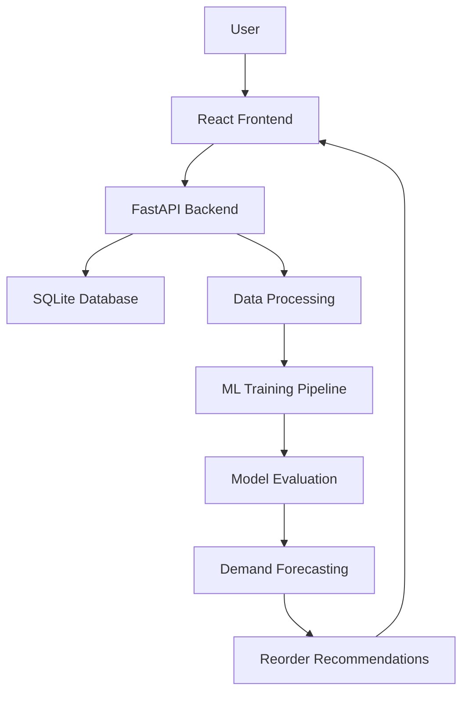

# SmartPantry – Smart Kitchen Inventory & Demand Forecasting System

A full-stack kitchen inventory management application that combines inventory tracking, expiry monitoring, sales management, food-waste analysis, and machine learning-based demand forecasting.

SmartPantry helps kitchen operators monitor stock levels, identify ingredients nearing expiry, understand usage patterns, and plan future purchases using demand predictions.

## Project Demo

**Watch the application demonstration:**

[▶ Watch SmartPantry Demo on YouTube](https://youtu.be/lWJLV27uWas)

The demo covers the dashboard, inventory management, sales tracking, expiry monitoring, ML-based demand forecasting, and analytics.

## Key Features

### 1. Dashboard
- Overview of inventory and stock value
- Low-stock notifications
- Upcoming expiry alerts
- Recent sales and inventory activity

### 2. Inventory Management
- Add, edit, and delete ingredients
- Manage ingredient categories and quantities
- Receive additional stock
- Export inventory information as CSV

### 3. Expiry Management
- Track ingredient expiry dates by batch
- Monitor ingredients approaching expiry
- Apply First Expiry, First Out (FEFO) when consuming batches

### 4. Sales Management
- Record ingredient-related sales transactions
- Automatically update inventory quantities
- Maintain sales transaction history

### 5. Food Waste Management
- Record wasted ingredients
- Track quantities and estimated ingredient costs
- Monitor waste-related losses

### 6. Machine Learning-Based Demand Forecasting
- Forecast ingredient demand for the next seven days
- Train and compare multiple regression models
- Select a model based on chronological holdout test MAE
- Generate reorder recommendations using predicted demand and stock information
- Import historical daily sales through CSV and retrain models

### 7. Analytics and Reporting
- Visualize inventory and sales information
- Review demand forecasts and model evaluation metrics
- Export inventory data for further analysis

## Technology Stack

| Component | Technologies |
|---|---|
| Frontend | React, JavaScript, Vite |
| Backend | Python, FastAPI |
| Database | SQLite, SQLAlchemy |
| Data Processing | Pandas, NumPy |
| Machine Learning | Scikit-learn |
| Forecasting Models | Random Forest, Extra Trees, HistGradientBoosting |
| Data Exchange | REST API, JSON, CSV |

## Machine Learning Methodology

SmartPantry includes a demand-forecasting pipeline designed to demonstrate how historical sales information can support kitchen inventory planning.

**Workflow:**

1. **Data collection:** Load historical daily ingredient sales.
2. **Preprocessing:** Prepare sales records and organize observations by date and ingredient.
3. **Model training:** Train Random Forest, Extra Trees, and HistGradientBoosting regression models.
4. **Model evaluation:** Use a chronological 80/20 training and holdout split.
5. **Model selection:** Select the model with the lowest holdout MAE for each ingredient.
6. **Forecasting:** Generate seven-day ingredient demand predictions.
7. **Reorder planning:** Use predicted demand and current inventory information to suggest replenishment quantities.

### Evaluation Metrics

The models are evaluated using:

- **MAE (Mean Absolute Error):** Average absolute difference between actual and predicted quantities.
- **RMSE (Root Mean Squared Error):** Measures prediction error while penalizing larger errors more heavily.
- **R² Score:** Indicates how well the model explains variation in the target values.

Actual evaluation results are generated by the application. No fixed accuracy percentage is claimed because forecasting performance depends on the data used.

## Dataset Information

### Default demonstration dataset

The application includes:

`backend/data/demo_sales.csv`

- 540 days of synthetic daily sales records
- Nine kitchen ingredients
- Deterministic sample data for reproducible demonstrations

**Important:** This is synthetic data, not real restaurant sales or a publicly collected kitchen dataset. It is included to demonstrate the forecasting workflow and allow the application to run offline.

### Importing your own sales data

The Demand Forecast page supports importing historical daily sales through CSV.

Required columns:

```csv
date,item_name,quantity
2026-01-01,Tomatoes,4.5
2026-01-01,Onions,2.0
2026-01-02,Tomatoes,5.0
```

Requirements:
- Dates must use `YYYY-MM-DD` format.
- Ingredient names must match the corresponding inventory/training item names.
- Quantity must contain numeric values.

After importing, the application retrains its forecasting models.

For meaningful real-world evaluation, use historical data from the target kitchen or restaurant and preserve a separate chronological test period. Metrics obtained from synthetic data should not be treated as evidence of real-world forecasting performance.

### Optional public dataset

An optional downloader is provided for the UCI Online Retail dataset.

**Source:** Chen, D. (2015). *Online Retail* [Dataset]. UCI Machine Learning Repository.

- Dataset: https://archive.ics.uci.edu/dataset/352/online+retail
- DOI: https://doi.org/10.24432/C5BW33
- Licence: CC BY 4.0

This dataset represents transactions from a UK online gift and novelty retailer, not a kitchen or food business. It can be used as a generic retail forecasting benchmark, but not as direct evidence of kitchen-specific performance.

To download it optionally:

```powershell
cd backend
.venv\Scripts\activate
pip install ucimlrepo
python download_uci_dataset.py
```

The optional downloader is not connected to the default application training pipeline.

## System Architecture



## Project Structure

```text
Smart-Pantry/
│
├── backend/
│   ├── app/
│   │   ├── FastAPI routes
│   │   ├── Database models
│   │   └── ML pipeline
│   ├── data/
│   │   └── demo_sales.csv
│   ├── requirements.txt
│   ├── run_backend.bat
│   ├── train_model.py
│   └── download_uci_dataset.py
│
├── frontend/
│   ├── src/
│   ├── package.json
│   ├── index.html
│   └── run_frontend.bat
│
├── run_all.bat
├── README.md
└── .gitignore
```

## Installation and Setup

### Prerequisites

- Windows 10 or Windows 11
- Python 3.11 or 3.12
- Node.js 20 or newer
- npm

### Run the application

1. Clone or download this repository.
2. Extract the project if downloaded as a ZIP.
3. Open the project root folder.
4. Double-click `run_all.bat`.
5. Wait for the backend and frontend terminals to start.

Open the application:

**Frontend:** http://127.0.0.1:5173

**Backend API documentation:** http://127.0.0.1:8000/docs

### Run services separately

**Backend – Terminal 1**

```powershell
cd backend
.\run_backend.bat
```

**Frontend – Terminal 2**

```powershell
cd frontend
.\run_frontend.bat
```

Run `run_all.bat` only from the project root directory.

## Troubleshooting

| Issue | Suggested solution |
|---|---|
| Frontend does not open | Check whether the frontend terminal is running and use Node.js 20+ |
| Backend API unavailable | Check the backend terminal and visit `/api/health` |
| Port 8000 already in use | Stop the process using the port or update the backend and frontend API configuration |
| npm installation fails | Run `npm install` from the frontend directory |
| Python dependencies fail | Use Python 3.11/3.12 and rerun the backend startup script |

The local SQLite database is stored at:

`backend/smartpantry.db`

Back up this file before resetting or deleting local application data.

## Security and Deployment Notes

SmartPantry is currently configured for local development and demonstration.

It does not currently include:
- User authentication and role-based access control
- CSRF protection
- Production deployment configuration
- Automated database backups

Do not use it with sensitive real-world business data or expose it publicly without implementing appropriate security and deployment safeguards.

## Third-Party Dependencies

The project uses third-party Python and JavaScript packages. Each dependency retains its respective licence. This repository does not claim ownership of or relicense third-party software.

## Future Enhancements

- Production deployment with a persistent database
- Authentication and role-based access control
- Integration with real kitchen or restaurant sales data
- More advanced time-series forecasting approaches
- Automated stock replenishment and supplier integration
- Improved monitoring and forecasting evaluation

## Author

**Nakshatra**

GitHub: https://github.com/nakshatra2506

---

*SmartPantry – Making kitchen inventory management smarter through data and machine learning.*
